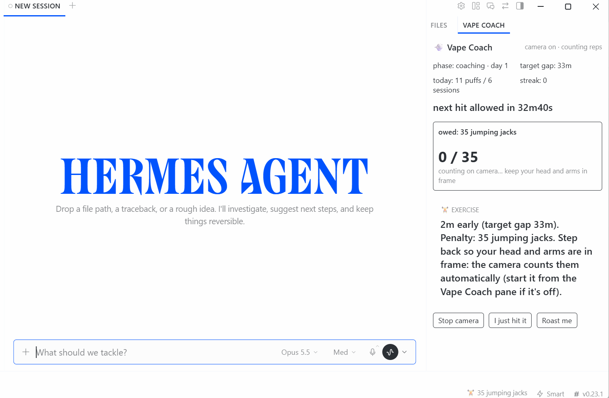

# Vape Coach

**Your agent writes the code. You reach for the vape. Vape Coach notices, and tapers you off.**

You ask the agent for a refactor and, while it works, your hand goes to the vape. Again. Nobody
counts those hits, and "I'll cut down tomorrow" never comes with a plan.

Vape Coach is a Hermes plugin that turns the time you spend waiting on your agent into a quit plan:

- **It sees the hit.** A local webcam watcher spots the hand going to your lips and the exhale
  after it, including the stealthy exhale into your shirt.
- **It sets the pace.** It spends a day just watching, then asks you to wait a little longer
  between sessions each day: about 10% more.
- **It holds you to it.** Hit early and the nudges escalate: first a roast, then a fake threat to
  your PR, then a protein-shake order, then jumping jacks that the camera counts by itself.
- **It never gets in the way of your work.** The agent always answers in full first, then teases
  you about the jacks you owe.



**▶ [Watch the 77-second demo](docs/demo.mp4)**: a hit on camera, the roast, the countdown, and jumping jacks counted hands-free.

## How it works

1. **Start the camera.** Click **Start camera** in the Vape Coach pane, or run `hermes vape watch`.
   Pose tracking runs at 2 fps while you work. The heavier face and hand models wake up only when
   your hand comes near your face.
2. **Day one is a baseline.** Hits are logged and nothing is said. Vape Coach learns your natural
   gap between sessions.
3. **Then the gap grows.** Each day's target gap is the baseline × 1.1^day. The status bar counts
   down to your next allowed hit.
4. **Hit early, climb the ladder.** Each early session today moves you one rung up:

   | Rung | Nudge | Example |
   |---|---|---|
   | 1 | Roast | *"Real 10x devs: ship features. You: ship flavor pods."* |
   | 2 | PR "threat" | *"Hit that again and your PR description becomes a 4,000-word essay on mango ice. /s - your code is safe."* |
   | 3 | Protein shake | *"Protein shake. Now. Replace the hand-to-mouth habit with 25g of something useful."* |
   | 4 | Jumping jacks | *"Penalty: 15 jumping jacks. Step back: the camera counts them automatically."* |

   Hitting at under 40% of the target gap skips a rung. Rung 4 and beyond add 10 reps each, up to 60.
5. **Step back and pay up.** When reps are owed, the same watcher switches to rep counting. The
   pane fills live and the challenge clears itself. You never type a command.
6. **Make the gap, earn a streak.** On-time sessions get praise and an on-time streak.

Example watcher output (lines from real runs, trimmed):

```text
camera open (dshow). Frames are processed in memory only.
[puff] t=17.1s dwell=2.95s exhale=1.0 grip=0.154 score=1.0
  >> [exercise] 12m early (target gap 33m). Penalty: 35 jumping jacks. Step back so your head and arms are in frame: the camera counts them automatically.
[reps] 35 jumping jacks owed. Step back so your head and arms are in frame: counting automatically.
  rep 1 (34 left)
  rep 2 (33 left)
  ...
  >> Challenge cleared: 35 jumping jacks (camera). Respect. Now stay off it for 33m.
[reps] all done: back to watching for hits.
```

And this is what the agent receives with your next message. It always does the work first:

```text
[vape-coach] The user just vaped. Queued nudge: "2m early (target gap 33m). Penalty: 35 jumping
jacks. ..." They still owe 35 jumping jacks. Answer their request fully first, then add ONE short
playful line about it. Never refuse, delay, or degrade the work; never modify code as a 'punishment'.
```

## Install

```bash
hermes plugins install vape-coach      # or: hermes plugins install https://github.com/NeelM0906/Vape-Coach
hermes plugins enable vape-coach       # installs mediapipe, opencv-contrib-python, numpy
```

Then restart Hermes (or run `hermes gateway restart`) so the gateway loads the plugin's backend.
Do this after every `hermes plugins update vape-coach` too; if you forget, the pane tells you.

In Hermes Desktop, open **Capabilities** (left sidebar) → **Plugins** → **Vape Coach** and switch
on the Desktop half. A **VAPE COACH** tab appears in the right panel and a countdown chip appears in
the status bar.

You need Hermes 0.23.0 or later and a webcam. On first start the watcher downloads three MediaPipe
models (about 30 MB, SHA256-pinned).

## Use it

**In Hermes Desktop.** Click **Start camera** and get back to work. The pane shows:

- your phase and the target gap
- a countdown to your next allowed hit
- any reps you owe, with a live progress bar
- the latest roast

Its buttons are **Start/Stop camera**, **I just hit it** (for a hit off camera) and **Roast me**.
There's no undo button: a hit you took stays logged.

**In chat:**

```text
/vape status      phase, target gap, time until your next allowed hit, reps owed
/vape hit [n]     log an off-camera hit
/vape stats       the last 7 days
/vape roast       a free roast
```

The agent also gets three tools (`vape_status`, `vape_log_hit`, `vape_stats`) and a bundled skill.
The skill sets the tone: roast the habit, not the person; never refuse or delay work; PR threats are
jokes only.

**In a terminal:**

```text
hermes vape watch       the same watcher as the Start camera button (Ctrl+C stops it)
hermes vape status      the same as /vape status
hermes vape undo        the camera got it wrong: void the last hit and the penalty it created
hermes vape reset --yes delete all Vape Coach data
```

## Settings

All settings live under `plugins.entries.vape-coach.settings` in `config.yaml`. You can also edit
them on the Settings page.

| Setting | Default | What it does |
|---|---|---|
| `baseline_hours` | `24` | Observe-only window. Set `0` to start coaching right away (handy for a demo). |
| `gap_growth_per_day` | `0.1` | How much the target gap grows each day. |
| `session_gap_s` | `300` | Puffs closer together than this count as one session. |
| `exercise` | `jumping_jacks` | Or `squats`, or `pushups`. |
| `reps_base` / `reps_step` / `reps_max` | `15` / `10` / `60` | Penalty size. |
| `verify_reps_with_camera` | `true` | `false` switches to the honor system: a **Done** button and `/vape done`. |
| `interventions` | all four | Drop the rungs you don't want; the nearest enabled one is used instead. |
| `camera_index` / `camera_backend` | `0` / `auto` | On Windows, `auto` tries DirectShow and then Media Foundation. |

On Windows, if the camera won't open, go to **Settings → Privacy & security → Camera** and turn on
*Camera access*, *Let apps access your camera* and *Let desktop apps access your camera*. Close
Teams or Zoom if they're holding the camera. If DirectShow shows a black frame, set
`camera_backend: msmf`.

## Under the hood

```
webcam → Pose lite @2 fps ── hand near face? ──► Pose + Face (blendshapes) + Hand @12 fps on a head crop
                                                 │
        hand→mouth distance · pinch grip · pursed lips / vapor cue · jaw · head tilt
                                                 │
        IDLE → APPROACH → DWELL (0.35–7 s at the lips) → RELEASE → EXHALE window (5 s) → score
```

A hit has to look like one. Each gate below rules out a common look-alike:

- **A device in a pinched grip.** An open hand gets rejected, which rules out snacks and scratching.
- **At least 0.3 s with the hand actually at the lips.** A brush past the mouth doesn't count.
- **A face that stays visible.** A mug or bottle hides it.
- **A level head.** Drinking tilts it back.
- **A dwell under 7 s.** Longer is a chin rest or a phone call.
- **Evidence of an exhale.** Pursed lips, or the texture loss and brightening of vapor in front of
  your mouth.

Puffs closer than 8 s apart count as one. The rep counter uses joint angles and switches to
arms-only mode automatically when your legs are out of frame. Puff detection pauses while you
exercise and for 15 s afterwards.

### How well it works

| Test | Result |
|---|---|
| Live desk test: normal, stealth and double puffs | 11 of 11 detected |
| Live: automatic rep counting | 5 jacks done, 5 counted, challenge cleared with no command |
| CPU at 640×480 | About 20% of one core idle, more while a hand is near your face |

**Known weak spot:** snacking, face-scratching and phone calls can still set off false alarms. In
the live test, the open-hand gate and score threshold would have caught 5 of 13. When one slips
through, `hermes vape undo` removes it along with its penalty. To measure accuracy on your own
recordings, see [`eval/RECORDING_GUIDE.md`](eval/RECORDING_GUIDE.md).

## Privacy and what it touches

- **Camera:** on only while the watcher runs. That's after you click **Start camera** (the plugin's
  backend then runs `python -m vapecoach.cli watch` as a child process, with a minimal allowlisted
  environment that carries none of Hermes' provider keys) or while `hermes vape watch`
  runs in your terminal. **Stop camera** or Ctrl+C turns it off, and the pane always shows the
  camera's state.
- **Frames:** processed in memory, never written to disk, never sent anywhere. The one exception is
  `--debug-out`, and only on a replay of your own video file.
- **Stored locally:** timestamps, scores and counts in
  `<hermes home>/plugin-data/vape-coach/data.db`, plus the watcher's text log, `watcher.log`.
  `hermes vape reset --yes` deletes the data.
- **Network:** a one-time download of three MediaPipe models from
  `storage.googleapis.com/mediapipe-models`, checked against pinned SHA256 hashes. Nothing else.
- **Never blocks you:** it doesn't block requests or gate tools, and it has no tool that can touch
  your code. The PR threats are jokes.
- **None of these:** LLM calls, credentials, telemetry, self-updating.

## Development

```bash
python -m pytest                          # 69 tests: detector, reps, auto-reps, taper, coach, glue, Desktop contract
hermes plugins validate . --install-deps
```

---

Not medical advice. If quitting is hard, talk to a doctor or call 1-800-QUIT-NOW (US). MIT licensed.
